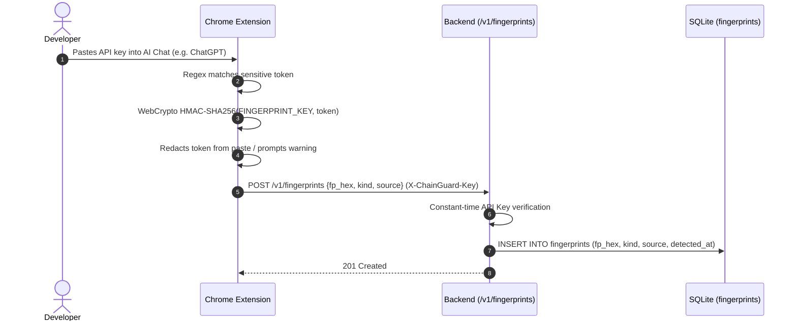
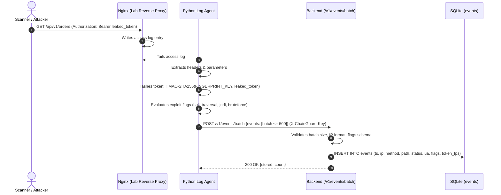
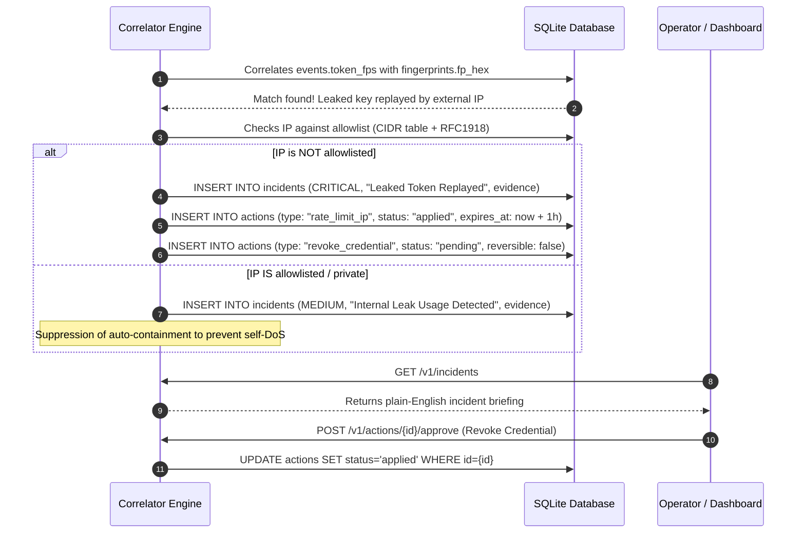

# ChainGuard Architecture & Threat Model

ChainGuard is a defensive security co-pilot designed for small engineering teams (1 to 50 developers) operating web applications and APIs without a dedicated 24/7 Security Operations Center (SOC).

Standard enterprise security tools either operate in silos (e.g., Dependabot in the repository, ModSecurity at the edge, browser DLP in corporate IT) or inundate founders with thousands of raw log lines and unprioritized CVE alerts. ChainGuard joins the entire chain—from an internal secret paste to dependency vulnerabilities and live web exploit attempts—into a single correlated, plain-English incident timeline.

---

## 1. System Components

```
+---------------------------------------------------------------------------------------+
|                                    CHAINGUARD SYSTEM                                  |
|                                                                                       |
|  +------------------------+      +------------------------+                           |
|  |   Browser Extension    |      |       Log Agent        |                           |
|  |  (Chrome Manifest V3)  |      |   (Python Log Tailer)  |                           |
|  |  - On-device detection |      |  - Tails Nginx logs    |                           |
|  |  - WebCrypto HMAC-SHA256|     |  - Local HMAC of tokens|                           |
|  |  - Zero raw text sent  |      |  - Heuristic flags     |                           |
|  +-----------+------------+      +-----------+------------+                           |
|              |                               |                                        |
|              | POST /v1/fingerprints         | POST /v1/events/batch (max 500)        |
|              | (X-ChainGuard-Key)            | (X-ChainGuard-Key)                     |
|              v                               v                                        |
|  +--------------------------------------------------------+                           |
|  |                   FastAPI Backend                      |                           |
|  |  +--------------------------------------------------+  |                           |
|  |  | Auth & Security Middlewares                      |  |                           |
|  |  | - Constant-time API Key verification             |  |                           |
|  |  | - HttpOnly, SameSite=Strict JWT for Dashboard   |  |                           |
|  |  | - Security Headers & In-Memory Rate Limiting     |  |                           |
|  |  +--------------------------------------------------+  |                           |
|  |  | Correlation Engine                               |  |                           |
|  |  | - Matches leak fingerprints to request tokens    |  |                           |
|  |  | - Cross-references attack paths with active deps |  |                           |
|  |  | - Explains attack & calculates exploitability    |  |                           |
|  |  +--------------------------------------------------+  |                           |
|  |  | Two-Speed Containment Engine                     |  |                           |
|  |  | - Speed 1: Auto-reversible IP rate-limit + TTL   |  |                           |
|  |  | - Speed 2: Human-approval for disruptive actions  |  |                           |
|  |  | - CIDR Allowlist Protection (No self-lockout)    |  |                           |
|  |  +--------------------------------------------------+  |                           |
|  |  | SQLite Storage (Parameterised ORM / SQLAlchemy)  |  |                           |
|  +---------------------------+----------------------------+                           |
|                              ^                                                        |
|                              | Session Cookie (HttpOnly JWT)                          |
|                              v                                                        |
|  +--------------------------------------------------------+                           |
|  |              React Dashboard (Vite + TS)               |                           |
|  |  - Plain-English Incident Briefings                    |                           |
|  |  - 1-Click Action Approval & Reversal                  |                           |
|  |  - Dependency Register & Scan Upload                   |                           |
|  +--------------------------------------------------------+                           |
+---------------------------------------------------------------------------------------+
```

### 1.1 Browser Paste Guard (`extension/`)
- **Runtime**: Chrome Extension (Manifest V3), TypeScript, WebCrypto API.
- **Scope**: Monitors paste events exclusively on configured generative AI interfaces (e.g., ChatGPT, Claude, Gemini, DeepSeek).
- **On-Device Redaction & Fingerprinting**:
  - Scans pasted text client-side for known credential formats (AWS keys, Stripe keys, GitHub tokens, database URIs, generic high-entropy bearer tokens).
  - Computes `HMAC-SHA256(key=FINGERPRINT_KEY, msg=secret_utf8)` entirely in-memory using the native browser WebCrypto API.
  - Transmits **only** `{fp_hex, kind, source}` to the backend. Raw secret text, surrounding code, and conversational context **never** leave the browser.

### 1.2 Dependency Register (`backend/` scan module)
- **Runtime**: FastAPI service parsing manifest and lock files (`package.json`, `package-lock.json`, `requirements.txt`).
- **Functionality**:
  - Maintains a live inventory of third-party libraries across active services.
  - Queries OSV / CVE advisories to extract associated exploit signatures (e.g., path traversal targets, JNDI lookups, SQL injection payloads).
  - Records vulnerability severity and maps which public endpoints invoke the affected dependencies.

### 1.3 Log Agent (`agent/`)
- **Runtime**: Lightweight standalone Python process using `watchdog` / file tailing and `httpx`.
- **Target**: Monitors web server / reverse proxy access logs (e.g., Nginx access log in front of OWASP Juice Shop).
- **Local Sanitization**:
  - Treats all incoming log fields as hostile. Truncates User-Agent strings to 200 characters.
  - Detects common exploit heuristics (`sqli`, `traversal`, `jndi`, `bruteforce`).
  - Locally computes `HMAC-SHA256(FINGERPRINT_KEY, token)` for values in `Authorization`, `X-API-Key`, and query parameters (`?key=`, `?token=`, `?api_key=`).
  - Transmits event batches (max 500 per request) over TLS authenticated via the `X-ChainGuard-Key` header. Raw credentials are never shipped.

### 1.4 Correlator Engine (`backend/`)
- **Runtime**: Python service executed upon event ingestion.
- **Link Logic**:
  - **Credential Leak Replay**: Compares incoming `token_fps` from server logs against stored `fingerprints`. A match proves a leaked secret is actively being replayed against production infrastructure.
  - **Contextual Exploitability**: When attack flags or URI patterns match a known CVE in `vulns`, the engine verifies whether the affected package is in `dependencies`:
    - If package is **installed and exposed**: Elevates severity to `CRITICAL` (confirmed vulnerable path under active probe).
    - If package is **not installed**: Downgrades severity to `LOW` (generic scanner noise; not exploitable in this environment).
  - **Plain-English Synthesis**: Formats the evidence into human-readable problem descriptions, root causes, and explicit remediation steps.

### 1.5 Two-Speed Containment Engine (`backend/`)
- **Speed 1 (Automatic & Reversible)**:
  - Low-impact mitigations: Temporary IP rate-limiting or connection throttling.
  - Must include an automated TTL (Time-To-Live) expiry and an instantaneous one-click undo option.
  - Protected by strict allowlist validation: Localhost (`127.0.0.1`, `::1`), RFC 1918 private subnets (`10.0.0.0/8`, `172.16.0.0/12`, `192.168.0.0/16`), and operator allowlisted CIDRs can **never** be blocked.
- **Speed 2 (Disruptive / Human-in-the-Loop)**:
  - High-impact actions: Revoking compromised credentials, isolating container network segments, taking vulnerable routes offline.
  - Requires explicit human approval via the dashboard before execution.

### 1.6 Dashboard (`dashboard/`)
- **Runtime**: React 18, Vite, TypeScript, Tailwind CSS.
- **Security**: Communicates via credentials-included HTTP requests backed by short-lived JWTs stored in `HttpOnly`, `SameSite=Strict` cookies. Never uses `dangerouslySetInnerHTML`.

---

## 2. End-to-End Data Flows

### Flow A: Secret Leak Detection (Extension to Backend)


### Flow B: Web Traffic Ingestion & Token Hashing (Log Agent to Backend)


### Flow C: Cross-Chain Correlation & Containment


---

## 3. Threat Model of ChainGuard

Because ChainGuard monitors hostile environments and manages defensive containment, the tool itself must resist adversarial exploitation.

### 3.1 Trust Boundaries
1. **Untrusted Internet / Lab Traffic -> Log Agent**: Access logs reflect unauthenticated, hostile payloads directly controlled by external attackers.
2. **External Web Sites -> Browser Extension**: Content scripts execute within untrusted origin DOMs (e.g., chat interfaces).
3. **Log Agent & Extension -> Backend API**: Both endpoints require explicit authentication via shared secret headers.
4. **Dashboard -> Backend API**: Browser sessions authenticate via signed, HttpOnly, SameSite cookies.
5. **Backend -> Lab Host / Nginx**: Containment commands interact with network infrastructure.

### 3.2 Threats & Mitigations (STRIDE Matrix)

| Threat Category | Concrete Threat Scenario | Impact | ChainGuard Defensive Control |
| :--- | :--- | :--- | :--- |
| **Spoofing** | Attacker floods `/v1/events/batch` or `/v1/fingerprints` to fake incidents or pollute DB. | DoS / Alert exhaustion | All ingest routes require `X-ChainGuard-Key` validated via constant-time comparison (`hmac.compare_digest`). Rate limiting per IP. |
| **Tampering** | Attacker injects SQL payloads or escape sequences inside `User-Agent` or `request_uri`. | SQL Injection / DB corruption | Strict Pydantic schemas; User-Agent truncated to 200 chars; 100% ORM parameterized queries (SQLAlchemy 2.x); no string formatting in SQL. |
| **Repudiation** | Operator approves or reverts containment action with no record. | Unaccountable production changes | All actions record state transitions (`pending` -> `applied` -> `undone` -> `expired`) with timestamps in the `actions` table. |
| **Information Disclosure** | Database backup or API leak exposes developer secrets or pasted code. | Catastrophic credential breach | Zero raw secrets stored anywhere. Both extension and agent hash secrets with `HMAC-SHA256` locally before transmission. |
| **Denial of Service** | Attacker spoofs traffic from legitimate IP (or VPN) to trigger auto-block of vital services. | Production outage / Self-lockout | Containment Engine enforces CIDR checks: `127.0.0.1`, RFC 1918 private ranges, and user allowlist can **never** be blocked. Auto-actions must be reversible with automatic TTL. |
| **Elevation of Privilege** | Attacker crafts a log message containing prompt injection to manipulate an LLM copilot. | Arbitrary action execution | Log content is treated as passive, hostile data. The LLM has **no execution tools**. All LLM output passes rigid Pydantic validation and **never** triggers actions automatically. |

### 3.3 LLM Safety Guardrails
- **No Direct Execution**: The correlation and incident ranking engine is rule-based and deterministic.
- **Untrusted Context**: When plain-English incident summaries are augmented with an LLM, log payloads are strictly wrapped as untrusted text blocks.
- **Schema Validation**: Any model response is validated against a static JSON schema. If the output fails validation, the system falls back to deterministic template-generated explanations.
